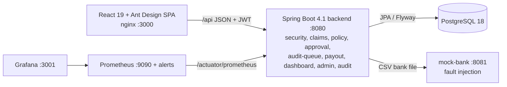

# ExpenseFlow - expense claims with policy-driven approvals (AI Manthan Team 33)

Employees capture expense claims with receipts; a configurable policy engine auto-approves, routes or auto-rejects each claim with a reason; claims flow manager -> finance auditor (> 25,000 INR) -> finance head (> 1,00,000 INR); auditors work a review queue with bulk approve and 10% sample audits; approved claims are paid through a CSV bank file to a mock bank. Append-only audit trail, role dashboards, super admin.

## Architecture

Claim flow: `DRAFT -> submit -> policy engine -> AUTO_APPROVED | AUTO_REJECTED | PENDING_MANAGER -> [PENDING_AUDITOR > 25,000] -> [PENDING_HEAD > 1,00,000] -> APPROVED -> payout batch -> PAID`. Full diagrams (context, containers, state machine, ER): [docs/architecture/README.md](docs/architecture/README.md).

## Run (one command)
Prerequisites: Docker Desktop. Then from the repo root:

```powershell
./start.ps1        # Windows
```
```bash
./start.sh         # macOS / Linux / Git Bash
```
Both run `docker compose up --build -d` with values from `.env` (copy `.env.example` to `.env` first; the scripts do it if `.env` is missing).

| Service | URL |
|---|---|
| Frontend | http://localhost:3000 |
| Backend health | http://localhost:8080/actuator/health |
| API docs (Swagger UI) | http://localhost:8080/swagger-ui.html |
| Mock bank | http://localhost:8081/actuator/health |
| Prometheus / Grafana | http://localhost:9090 / http://localhost:3001 |

Stop: `docker compose down` (add `-v` to wipe the database and re-seed).

## Personas and demo logins (password `Demo@123`)
| Persona | Email | What to show |
|---|---|---|
| Priya Employee | `employee@expenseflow.test` | My claims, new claim with receipt (mobile at 360px), policy result with reasons, resubmit after send-back |
| Rahul Manager | `manager@expenseflow.test` | Approval inbox, side-by-side receipt viewer, approve / reject / send back, delegate to Meera |
| Meera Backup | `manager2@expenseflow.test` | Acts on Rahul's claims while delegated (recorded "on behalf of") |
| Anita Auditor | `auditor@expenseflow.test` | Audit queue with filters, bulk approve, sample audits (AUDITOR level is a team pool) |
| Farhan Head | `head@expenseflow.test` | Claims > 1,00,000, payout batch -> CSV -> mock bank -> PAID, policy rules (also super admin) |
| Abhishek Admin | `admin@expenseflow.test` | Super admin: overview (1D/7D/1M/Custom), users and roles, audit log, health |

Seed: 150 employees in 8 departments, ~3,000 claims dated relative to today ([seed summary](docs/testing/seed-summary.md)).

**Demo claims** (Priya): `DEMO-1001` draft · `1002` auto-approved · `1003` auto-rejected (missing receipt) · `1004` pending manager (weekend flag) · `1005` pending auditor (30,000) · `1006` pending head (1,20,000) · `1007` clarification requested · `1008` approved (payable) · `1009` paid · `1010` duplicate receipt rejected.

## Tests
```bash
cd backend && ./mvnw -B verify            # unit + API tests on PostgreSQL 18 (Testcontainers, Docker running)
cd frontend && npm run lint && npm run build && npm test -- --run
cd tests/e2e && npm ci && npx playwright test   # stack running; API RBAC matrix + UI flows + axe a11y
```
CI (GitHub Actions) runs all of these plus the OWASP dependency check and image builds on every PR.

## Integration pass (T-190)
A fresh clone was started with `./start.ps1` on alternate ports, and every persona's flow was then walked through the API and the web routes: 45 checks, covering auto-approve and auto-reject, routing, approve, send-back and resubmit, delegation, auditor bulk approve and sample audit, payout batch -> CSV -> mock bank -> PAID, dashboards for every role, the admin pages, the 403 rules, and all main web routes. The one blocker found (the AUDITOR step was invisible to all auditors except the least-loaded one) was fixed by making the AUDITOR level a team pool ([ADR-001 amendment](docs/adr/ADR-001-approval-chain-model.md)).

## Docs map
- Requirements (FR/BR/NFR, seed spec): [docs/requirements.md](docs/requirements.md)
- Architecture (context, containers, state machine, ER): [docs/architecture/README.md](docs/architecture/README.md)
- RBAC: [docs/architecture/rbac.md](docs/architecture/rbac.md) · Failure modes + approval-bypass review: [docs/architecture/failure-modes.md](docs/architecture/failure-modes.md)
- ADRs: [ADR-001 approval chain](docs/adr/ADR-001-approval-chain-model.md) · [ADR-002 policy as configuration](docs/adr/ADR-002-policy-as-configuration.md)
- API contract: [contracts/openapi.yaml](contracts/openapi.yaml)
- Sprint tracker: [docs/tracking/squad-tracker.xlsx](docs/tracking/squad-tracker.xlsx)
- Reusable AI assets: [prompt pack](docs/prompts/prompt-pack.md) and the **squad kit**, which coordinates 6 laptops over git: `squad` CLI (task board on branch `squad/board`, atomic claims, dependency-aware `next`, Excel tracker export) plus the `/squad-work`, `/squad-milestone-check` and `/squad-journal` Claude skills. Every laptop ran `/loop /squad-work`, and L1 ran a rebalancer that moved waiting tasks to idle laptops.


## Submission artefacts
- Tests: [test plan](docs/testing/test-plan.md) · [test cases](docs/testing/test-cases.md) · [test results](docs/testing/test-results.md) · [defect log](docs/testing/defect-log.md) · [RBAC matrix](docs/testing/rbac-matrix.md) · E2E: [tests/e2e](tests/e2e)
- SRE: [runbook](docs/sre/runbook.md) · [drill RCA](docs/sre/rca-drill.md) · [alerts](infra/prometheus/alerts.yml)
- Claude usage: [CLAUDE.md](CLAUDE.md) · [prompt pack](docs/prompts/prompt-pack.md) · [journals](docs/claude-journal)
- Sprint reviews + demo script: [docs/sprints](docs/sprints) · tracker: [squad-tracker.xlsx](docs/tracking/squad-tracker.xlsx)
