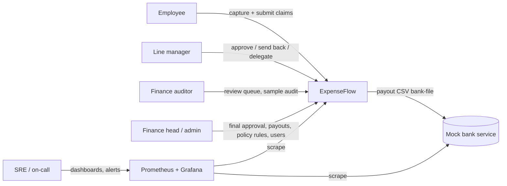
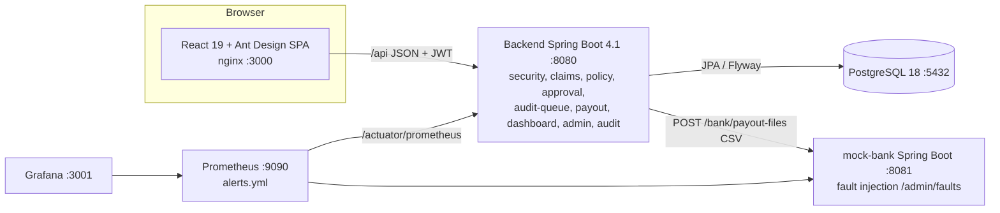
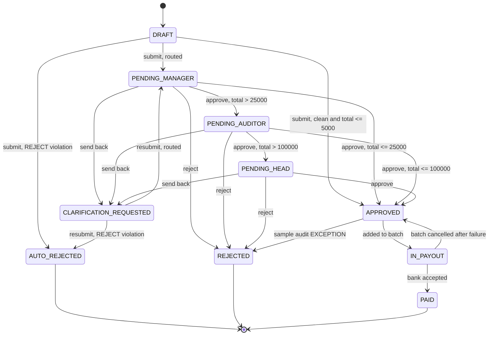
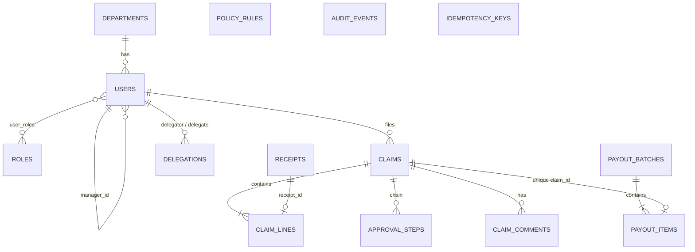

# Architecture - ExpenseFlow

Related: [requirements](../requirements.md) · [rbac](rbac.md) · [failure modes](failure-modes.md) · [ADR-001 approval chain](../adr/ADR-001-approval-chain-model.md) · [ADR-002 policy as configuration](../adr/ADR-002-policy-as-configuration.md) · [contract](../../contracts/openapi.yaml)

## 1. Context

## 2. Containers

## 3. Claim state machine

Note: a resubmitted claim that is clean and <= 5,000 is auto-approved like a first submit.

## 4. Data model

Key columns: `claims(id, code, employee_id, title, status, total_amount, policy_outcome, policy_result jsonb, sample_audit NONE|PENDING|OK|EXCEPTION, submitted_at, decided_at, version)`, `claim_lines(id, claim_id, category MEAL|HOTEL|CAB|TRAVEL|OTHER, amount, expense_date, vendor, description, city, nights, receipt_id, violations jsonb)`, `receipts(id, owner_id, file_name, content_type, size, sha256, content bytea)`, `approval_steps(id, claim_id, level MANAGER|AUDITOR|HEAD, assignee_id, acted_by_id, on_behalf_of_id, decision, comment, created_at, decided_at)`, `delegations(id, delegator_id, delegate_id, from_date, to_date, active)`, `policy_rules(code, category, limit_amount, unit, params jsonb, action, enabled, updated_by, updated_at)`, `payout_batches(id, status CREATED|SUBMITTED|PAID|SUBMIT_FAILED|CANCELLED, total, item_count, bank_reference, value_date, version)`, `audit_events(id, at, actor_id, on_behalf_of_id, action, entity_type, entity_id, before jsonb, after jsonb)` append-only, `idempotency_keys(key, user_id, request_hash, status, response jsonb, created_at)`.

## 5. Backend package layout (`com.expenseflow`) and owner
| Package | Owner | Content |
|---|---|---|
| `config` | L2 | app config, OpenAPI, Jackson |
| `domain`, `repository` | L2 | entities (Claim, ClaimLine, Receipt, ApprovalStep, Delegation, PolicyRule, PayoutBatch, Department), repositories |
| `api` | L2 | ClaimController, ReceiptController, PolicyRuleController, DepartmentController, PayoutController + global error handler |
| `policy` | L2 | PolicyEngine (pure, rule-per-class, reads `policy_rules`) |
| `payout` | L2 | batch service + CSV writer |
| `seed` | L2 | Datafaker generator, profile `seed` |
| `security` | L3 | Spring Security, JWT, AuthController, users/roles |
| `approval` | L3 | ApprovalService (chain resolver, delegation), ApprovalController, DelegationController, AuditQueueController |
| `audit`, `idempotency` | L3 | AuditService.record(...), Idempotency filter/aspect |
| `integration` | L3 | MockBankClient (timeouts, metrics) |
| `admin`, `dashboard`, `observability` | L3 | admin APIs, KPI queries, custom gauges, page-load telemetry |

## 6. Cross-cutting decisions
- Errors: `@RestControllerAdvice` -> `{code, message, details}`; codes listed in the contract.
- Idempotency: header required on state-changing POSTs (NFR-IDEM).
- Concurrency: `@Version` optimistic locking + state checks.
- Audit: `AuditService.record(action, entity, before, after)` called in the same transaction as the change.
- Time: all timestamps `timestamptz`, UTC in API, UI shows local (Asia/Kolkata).
