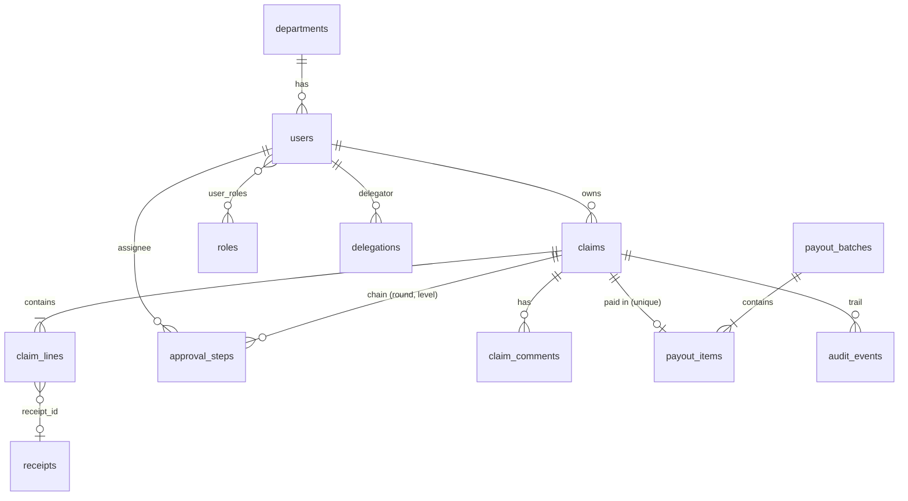
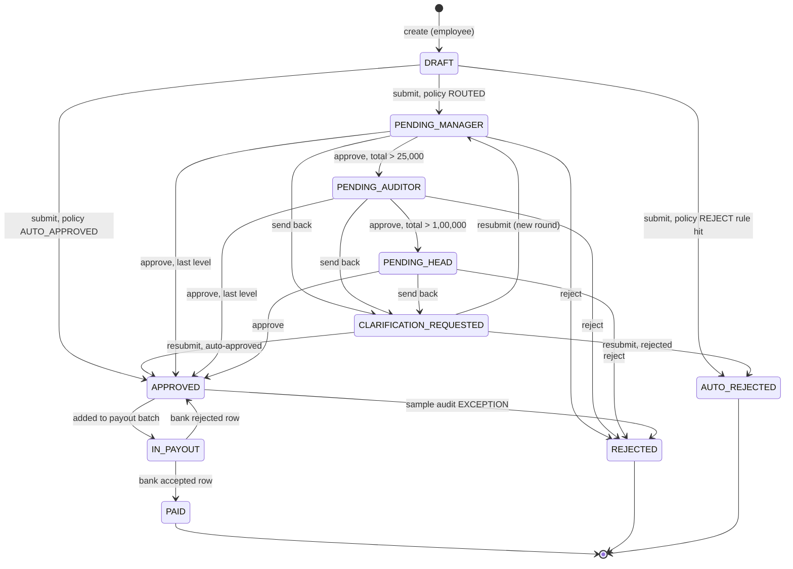
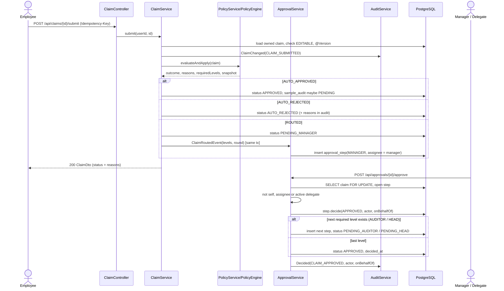

# ExpenseFlow - Low-Level Design (LLD)

Taken from the code on `main` (backend `com.expenseflow`, Flyway `V1`..`V7`). The high-level view is in [README.md](README.md); the decisions are in [ADR-001](../adr/ADR-001-approval-chain-model.md) and [ADR-002](../adr/ADR-002-policy-as-configuration.md); access rules are in [rbac.md](rbac.md); the API contract is [contracts/openapi.yaml](../../contracts/openapi.yaml).

Stack: Spring Boot 4.1 / Java 17, Spring Data JPA (`ddl-auto=validate`), Flyway, PostgreSQL 18, JWT (stateless), Micrometer -> Prometheus. Frontend is React + Ant Design (not covered here).

## 1. Packages

| Package | Responsibility | Main classes |
|---|---|---|
| `api` | Core REST controllers, DTO records, error mapping | `ClaimController`, `ReceiptController`, `PayoutController`, `PolicyRuleController`, `DepartmentController`, `GlobalExceptionHandler`, `ApiError {code,message,details}`, `ErrorCodes`, `CurrentUser` |
| `service` | Claim use cases (`@Transactional`) | `ClaimService` (create/update/delete/submit/comments), `ReceiptService`, `ClaimEvents` |
| `domain` | JPA entities + enums (state, levels, rule units) | `Claim`, `ClaimLine`, `Receipt`, `ApprovalStep`, `Delegation`, `PayoutBatch`, `PayoutItem`, `PolicyRule`, `User`, `Role`, `Department`, `ClaimStatus`, `PayoutBatchStatus`, `ApprovalLevel`, `PolicyAction`, `PolicyOutcome`, `SampleAudit` |
| `repository` | Spring Data JPA repositories (incl. `findByIdForUpdate` = `PESSIMISTIC_WRITE`) | one per aggregate |
| `policy` | Pure policy engine + rule admin | `PolicyEngine`, `PolicyRuleEvaluator`, `rules.PolicyRules`, `PolicyService`, `PolicyRuleAdminService` |
| `approval` | Approval chain, delegation, auditor queue | `ApprovalService`, `ApproverDirectory`, `DelegationService`, `AuditQueueService`, controllers |
| `payout` | Payout batches, CSV, bank submit | `PayoutService` |
| `integration` | Outbound HTTP to the mock bank | `MockBankClient` |
| `audit` | Append-only audit trail from domain events | `AuditService` (`@EventListener`), `AuditEvent`, `ClaimAuditTimelineService` |
| `idempotency` | `Idempotency-Key` replay for `@Idempotent` POSTs | `IdempotencyFilter`, `IdempotencyStore` |
| `security` | Sign-up, login, JWT, rate limit, JSON 401/403 | `AuthService`, `JwtTokenService`, `LoginAttemptLimiter`, `SecurityConfig` |
| `dashboard` | KPIs per role and date range (1D/7D/1M/custom) | `KpiService`, `DateRange` |
| `admin` | Super admin: users, roles, audit log, overview, health | `AdminUserService`, `AdminInsightsService` |
| `observability` | Custom metrics | `ApprovalQueueMetrics`, `BankCallMetrics`, `HttpErrorRateTracker` |
| `seed` | Demo data (profile `seed`, fixed random seed, dates relative to now) | `SeedService`, `SeedRunner` |

Layering: controller -> service -> repository / pure domain. Controllers never set a status; services do it and publish an event that `AuditService` turns into an `audit_events` row **in the same transaction**.

## 2. Data model (JPA entity <-> Flyway table)

| Entity | Table (migration) | Key columns and constraints |
|---|---|---|
| `Department` | `departments` (V2) | id, name |
| `User` | `users` (V2) | email unique, BCrypt password, department, manager |
| `Role` | `roles`, `user_roles` (V2) | EMPLOYEE, MANAGER, FINANCE_AUDITOR, FINANCE_HEAD, SUPER_ADMIN |
| `Receipt` | `receipts` (V3) | `content_type` in pdf/jpeg/png, `size <= 5 MB` (BR-20), `sha256` indexed (duplicate detection), BYTEA content |
| `Claim` | `claims` (V3, V6) | `code` unique (sequence, V6), `status` CHECK (10 states), `total_amount NUMERIC(12,2) >= 0`, `policy_outcome`, `policy_result JSONB` (snapshot), `sample_audit`, `version` (optimistic lock), CHECK submitted_at set when not DRAFT, paid_at set when PAID |
| `ClaimLine` | `claim_lines` (V3) | `(claim_id, line_no)` unique, category CHECK, `amount > 0`, HOTEL needs `nights`, `violations JSONB`, index on `(lower(trim(vendor)), amount, expense_date)` for BR-6 |
| `ApprovalStep` | `approval_steps` (V3) | `(claim_id, round, level)` unique, level MANAGER/AUDITOR/HEAD, `assignee_id`, `acted_by_id`, `on_behalf_of_id` (delegation), decision APPROVED/REJECTED/SENT_BACK, CHECK decision <-> decided_at <-> actor, partial index on pending steps |
| `Delegation` | `delegations` (V3) | not self, `to_date >= from_date`, max 30 days (BR-14) |
| `ClaimComment` | `claim_comments` (V3) | non-empty body |
| `PayoutBatch` | `payout_batches` (V3, V7) | status CHECK, item_count, total, value_date, bank_reference, bank_file_id / last_error (V7), `version` |
| `PayoutItem` | `payout_items` (V3) | **`claim_id` unique** - a claim can be in only one batch |
| `PolicyRule` | `policy_rules` (V4) | PK `code`, category, `limit_amount`, unit, `params JSONB`, action ROUTE/REJECT, enabled, `version` |
| `AuditEvent` | `audit_events` (V5) | entity type/id, action, actor, on-behalf-of, before/after JSON, timestamp (append-only) |
| - | `idempotency_keys` (V5) | key + user + request hash -> stored response |



Money is `NUMERIC(12,2)` / `BigDecimal` (never `double`). Concurrency: `@Version` on `Claim`, `PayoutBatch`, `PolicyRule` (-> 409 `CONCURRENT_MODIFICATION`); `SELECT ... FOR UPDATE` (`findByIdForUpdate`) on approval decisions and payout submit.

## 3. Claim state machine

`ClaimStatus`: DRAFT, PENDING_MANAGER, PENDING_AUDITOR, PENDING_HEAD, CLARIFICATION_REQUESTED, APPROVED, REJECTED, AUTO_REJECTED, IN_PAYOUT, PAID.



| Transition | Where | Guard / error |
|---|---|---|
| edit / delete / submit | `ClaimService` | only DRAFT or CLARIFICATION_REQUESTED (`EDITABLE`), owner only (others get 404); else 409 `ILLEGAL_STATE_TRANSITION`; no lines -> 422 `CLAIM_EMPTY` |
| approve / reject / send back | `ApprovalService.decide` | row lock; not own claim (403 `SELF_APPROVAL_FORBIDDEN`); actor = open step's assignee or active delegate (403 `NOT_ASSIGNED_APPROVER`); claim status must match the step level (409) |
| sample audit OK / EXCEPTION | `AuditQueueService` | EXCEPTION needs a comment of at least 3 chars and status APPROVED |
| APPROVED -> IN_PAYOUT -> PAID / APPROVED | `PayoutService` | `payout_items.claim_id` unique; per-row bank result |

Every transition publishes `ClaimChanged` / `ApprovalEvents.Decided` -> `AuditService` writes before/after JSON, actor and on-behalf-of.

Payout batch: `CREATED -> SUBMITTED -> PAID`, `SUBMITTED -> SUBMIT_FAILED -> SUBMITTED` (retry). Only CREATED or SUBMIT_FAILED can be submitted (`SUBMITTABLE`).

## 4. Policy evaluation (BR-1..BR-13, ADR-002)

Rules are data (`policy_rules`) that the finance head edits in `PUT /api/policy-rules/{code}` (`PolicyRuleAdminService`, `@Version`, audited, publishes `PolicyRuleChangedEvent`). The logic is code: one `PolicyRuleEvaluator` per code in `policy.rules.PolicyRules`.

| Code | Rule | Default |
|---|---|---|
| MEAL_DAILY_LIMIT | BR-1 meals per employee per day | 1,500 INR, ROUTE |
| HOTEL_NIGHTLY_LIMIT | BR-2/3 per night, tier-1 cities vs others (`params`) | 6,000 / 4,000 INR, ROUTE |
| CAB_TRIP_LIMIT | BR-4 per trip | 2,000 INR, ROUTE |
| RECEIPT_REQUIRED | BR-5 receipt above limit | 500 INR |
| DUPLICATE_LINE | BR-6 same vendor + amount + date | - |
| DUPLICATE_RECEIPT | BR-7 same file SHA-256 | - |
| WEEKEND_SPEND | BR-8 weekend flag | - |
| AUTO_APPROVE_MAX | BR-9 setting | 5,000 INR |
| CHAIN_AUDITOR_ABOVE | BR-11 setting | 25,000 INR |
| CHAIN_HEAD_ABOVE | BR-12 setting | 1,00,000 INR |
| SAMPLE_AUDIT_RATE | BR-13 share of auto-approved claims sampled | 0.1 |

`PolicyEngine.evaluate(lines, rules, context)` - pure Java, deterministic:
1. Sort lines by `line_no`; for every line run every **enabled** rule that has an action -> list of `Violation {code, message, action}` stored on the line (`claim_lines.violations`).
2. Outcome: any REJECT -> `AUTO_REJECTED`; else any ROUTE -> `ROUTED`; else total <= `AUTO_APPROVE_MAX` -> `AUTO_APPROVED`; else `ROUTED`. Every outcome carries human reasons.
3. Required levels for ROUTED: MANAGER always (BR-10), + AUDITOR if total > `CHAIN_AUDITOR_ABOVE` (BR-11), + HEAD if total > `CHAIN_HEAD_ABOVE` (BR-12).
4. `PolicyService.evaluateAndApply` saves the result as a JSONB snapshot (`claims.policy_result`) together with the rule config used, so later rule edits never change past decisions.
5. Auto-approved claims are flagged `sample_audit = PENDING` with probability `SAMPLE_AUDIT_RATE`.

## 5. Sequence: submit and approval chain



Steps are created lazily (only the current level is open). Send back -> CLARIFICATION_REQUESTED; resubmit starts round `max(round) + 1`.

## 6. Sequence: payout batch -> CSV -> bank

```mermaid
sequenceDiagram
    actor H as Finance Head
    participant PC as PayoutController
    participant PY as PayoutService
    participant DB as PostgreSQL
    participant BK as MockBankClient -> mock-bank :8081
    H->>PC: POST /api/payout-batches (Idempotency-Key)
    PC->>PY: create(actorId)
    PY->>DB: APPROVED claims (not already in a batch) -> payout_items, claims IN_PAYOUT, batch CREATED
    H->>PC: GET /api/payout-batches/{id}/export.csv
    PC->>PY: csv(id) (bank format, BR-17)
    H->>PC: POST /api/payout-batches/{id}/submit
    PC->>PY: submit(id, actorId)
    Note over PY,DB: tx 1: lock batch, CREATED/SUBMIT_FAILED -> SUBMITTED, build CSV, commit
    PY->>BK: submit(csv, key "payout-batch-{id}") - no tx open
    alt timeout / 5xx / REJECTED
        PY->>DB: tx: batch SUBMIT_FAILED + last_error (retry allowed, same key -> bank pays once)
    else ACCEPTED / PARTIALLY_ACCEPTED
        PY->>DB: tx 2: accepted rows -> claim PAID + paid_at; rejected rows -> claim APPROVED, item removed; batch PAID + bank_reference
    end
    PY-->>H: batch DTO (status, last_error)
```

Metrics: `expenseflow_bank_submit_total{result}`, bank call latency (`BankCallMetrics`); alerts in `infra/prometheus/alerts.yml`, runbook in [../sre/runbook.md](../sre/runbook.md).

## 7. Endpoint -> service map

| Endpoint | Roles | Service method |
|---|---|---|
| `POST /api/auth/signup`, `/login`; `GET /api/auth/me` | public / any | `AuthService` (sign-up = EMPLOYEE only, login rate limit) |
| `GET /api/claims` | EMPLOYEE, MANAGER, FIN_AUDITOR, FIN_HEAD | `ClaimService.myClaims` |
| `POST /api/claims`, `PUT/DELETE /api/claims/{id}` | same, owner only | `create` / `update` / `delete` |
| `GET /api/claims/{id}` | same, owner or approver/finance | `ClaimService.visible` |
| `POST /api/claims/{id}/submit` (idempotent) | owner | `ClaimService.submit` -> `PolicyService` -> `ApprovalService.onRouted` |
| `GET/POST /api/claims/{id}/comments` | visible users | `comments` / `addComment` |
| `GET /api/claims/{id}/audit` | visible users | `ClaimAuditTimelineService.timeline` |
| `POST /api/receipts`, `GET /api/receipts/{id}/content` | claim roles | `ReceiptService.upload` / `visible` |
| `GET /api/approvals/inbox` | MANAGER, FIN_AUDITOR, FIN_HEAD | `ApprovalService.inbox` (own + delegated) |
| `POST /api/approvals/{id}/approve\|reject\|send-back` (idempotent) | same | `ApprovalService.decide` |
| `GET/POST /api/delegations`, `DELETE /api/delegations/{id}` | same | `DelegationService.mine` / `create` / `revoke` |
| `GET /api/users/approvers` | approvers, SUPER_ADMIN | `ApproverDirectory` |
| `GET /api/audit-queue`, `POST /bulk-approve` (idempotent), `POST /{id}/sample-audit` | FIN_AUDITOR, FIN_HEAD | `AuditQueueService` |
| `GET /api/payout-batches`, `/eligible`, `/{id}`, `/{id}/export.csv` | FIN_AUDITOR, FIN_HEAD | `PayoutService.page` / `eligible` / `read` / `csv` |
| `POST /api/payout-batches`, `/{id}/submit` (idempotent) | FIN_HEAD | `PayoutService.create` / `submit` |
| `GET /api/policy-rules` | MANAGER, FIN_AUDITOR, FIN_HEAD, SUPER_ADMIN | `PolicyRuleAdminService.list` |
| `PUT /api/policy-rules/{code}` | FIN_HEAD | `PolicyRuleAdminService.update` |
| `GET /api/dashboard/kpis?range=` | authenticated, scoped by role | `KpiService` |
| `GET/POST /api/admin/users`, `PUT /users/{id}/roles`, `PATCH /users/{id}`, `GET /audit`, `/overview`, `/health` | SUPER_ADMIN | `AdminUserService`, `AdminInsightsService` |
| `GET /api/departments` | authenticated | `DepartmentRepository` |

## 8. Cross-cutting

- **Errors:** `GlobalExceptionHandler` -> `{code, message, details}`: 400 validation, 401 no/invalid token (JSON), 403 role or not assigned, 404 not found or not yours, 409 illegal transition / concurrent change / idempotency conflict, 422 business refusal.
- **Idempotency:** `@Idempotent` POSTs need an `Idempotency-Key`; `IdempotencyFilter` stores the first response in `idempotency_keys` and replays it on a retry with the same body (different body -> 409).
- **Security:** stateless JWT, BCrypt, `@PreAuthorize` on every endpoint as in [rbac.md](rbac.md), ownership checked in services.
- **Audit:** every state change and rule edit -> `audit_events` (who, on behalf of whom, before/after) in the same transaction; shown per claim and in the admin audit log.
- **Observability:** Actuator + Prometheus (`/actuator/prometheus`), approval-queue gauges, bank call metrics, HTTP error rate; Grafana dashboard "ExpenseFlow overview".
